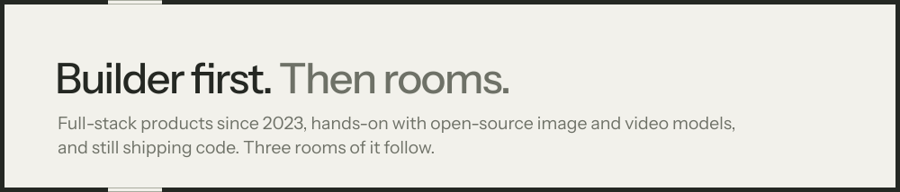
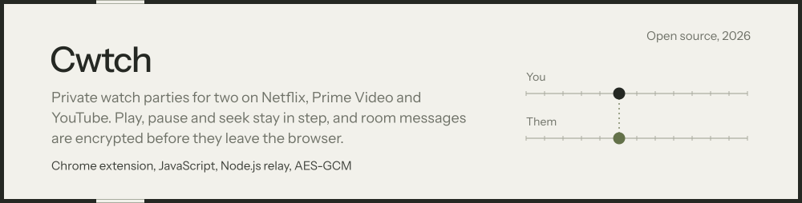
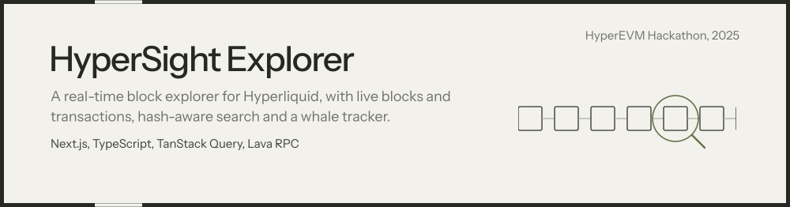
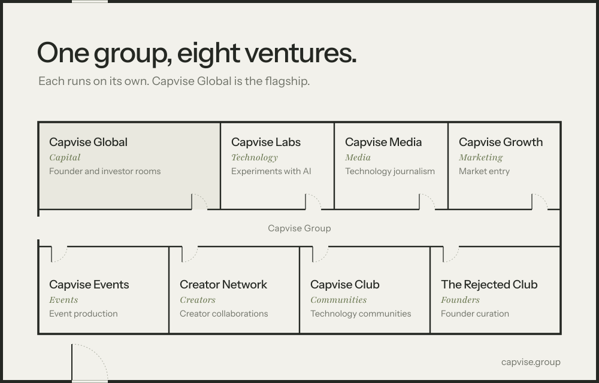

<a href="https://sahil.capvise.group">
  <picture>
    <source media="(prefers-color-scheme: dark)" srcset="assets/entrance-dark.svg">
    
  </picture>
</a>

  <a href="https://sahil.capvise.group">Portfolio</a>&nbsp;&nbsp;&nbsp;&nbsp;&nbsp;
  <a href="https://x.com/sahilxdev">X</a>&nbsp;&nbsp;&nbsp;&nbsp;&nbsp;
  <a href="https://linkedin.com/in/sahilxdev">LinkedIn</a>&nbsp;&nbsp;&nbsp;&nbsp;&nbsp;
  <a href="https://t.me/sahilxdev">Telegram</a>&nbsp;&nbsp;&nbsp;&nbsp;&nbsp;
  <a href="mailto:sahil@capvise.group">Email</a>&nbsp;&nbsp;&nbsp;&nbsp;&nbsp;
  <a href="https://luma.com/capvise">Events</a>

<a href="https://global.capvise.group">
  <picture>
    <source media="(prefers-color-scheme: dark)" srcset="assets/rooms-dark.svg">
    
  </picture>
</a>

<a href="https://luma.com/capvise">
  <picture>
    <source media="(prefers-color-scheme: dark)" srcset="assets/y2027-dark.svg">
    
  </picture>
</a>

<a href="https://github.com/sahilxdev?tab=repositories">
  <picture>
    <source media="(prefers-color-scheme: dark)" srcset="assets/builder-dark.svg">
    
  </picture>
</a>

<a href="https://github.com/sahilxdev/cwtch-public">
  <picture>
    <source media="(prefers-color-scheme: dark)" srcset="assets/cwtch-dark.svg">
    
  </picture>
</a>

<a href="https://github.com/sahilxdev/Omni_Sweep">
  <picture>
    <source media="(prefers-color-scheme: dark)" srcset="assets/omnisweep-dark.svg">
    
  </picture>
</a>

<a href="https://github.com/sahilxdev/hypersightexplorer">
  <picture>
    <source media="(prefers-color-scheme: dark)" srcset="assets/hypersight-dark.svg">
    
  </picture>
</a>

<a href="https://capvise.group">
  <picture>
    <source media="(prefers-color-scheme: dark)" srcset="assets/group-dark.svg">
    
  </picture>
</a>

  <a href="https://global.capvise.group">Capvise Global</a>&nbsp;&nbsp;&nbsp;&nbsp;&nbsp;
  <a href="https://labs.capvise.group">Labs</a>&nbsp;&nbsp;&nbsp;&nbsp;&nbsp;
  <a href="https://media.capvise.group">Media</a>&nbsp;&nbsp;&nbsp;&nbsp;&nbsp;
  <a href="https://growth.capvise.group">Growth</a>&nbsp;&nbsp;&nbsp;&nbsp;&nbsp;
  <a href="https://events.capvise.group">Events</a>&nbsp;&nbsp;&nbsp;&nbsp;&nbsp;
  <a href="https://creators.capvise.group">Creator Network</a>&nbsp;&nbsp;&nbsp;&nbsp;&nbsp;
  <a href="https://club.capvise.group">Club</a>&nbsp;&nbsp;&nbsp;&nbsp;&nbsp;
  <a href="https://rejectedclub.com">The Rejected Club</a>

<a href="mailto:sahil@capvise.group">
  <picture>
    <source media="(prefers-color-scheme: dark)" srcset="assets/block-dark.svg">
    
  </picture>
</a>

<!-- The sheets are drawn by source/sheets.py. See source/README.md to change them. -->
