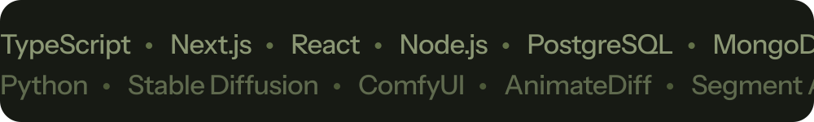

  <a href="https://sahil.capvise.group">Portfolio</a>&nbsp;&nbsp;&nbsp;&nbsp;&nbsp;
  <a href="https://x.com/sahilxdev">X</a>&nbsp;&nbsp;&nbsp;&nbsp;&nbsp;
  <a href="https://linkedin.com/in/sahilxdev">LinkedIn</a>&nbsp;&nbsp;&nbsp;&nbsp;&nbsp;
  <a href="https://t.me/sahilxdev">Telegram</a>&nbsp;&nbsp;&nbsp;&nbsp;&nbsp;
  <a href="mailto:sahil@capvise.group">Email</a>&nbsp;&nbsp;&nbsp;&nbsp;&nbsp;
  <a href="https://luma.com/capvise">Events</a>

  
  
  

  <a href="https://global.capvise.group">Capvise Global</a>&nbsp;&nbsp;&nbsp;&nbsp;&nbsp;
  <a href="https://labs.capvise.group">Labs</a>&nbsp;&nbsp;&nbsp;&nbsp;&nbsp;
  <a href="https://media.capvise.group">Media</a>&nbsp;&nbsp;&nbsp;&nbsp;&nbsp;
  <a href="https://growth.capvise.group">Growth</a>&nbsp;&nbsp;&nbsp;&nbsp;&nbsp;
  <a href="https://events.capvise.group">Events</a>&nbsp;&nbsp;&nbsp;&nbsp;&nbsp;
  <a href="https://creators.capvise.group">Creator Network</a>&nbsp;&nbsp;&nbsp;&nbsp;&nbsp;
  <a href="https://club.capvise.group">Club</a>&nbsp;&nbsp;&nbsp;&nbsp;&nbsp;
  <a href="https://rejectedclub.com">The Rejected Club</a>

<!-- The scenes are drawn by source/scenes.py. See source/README.md to change them. -->
