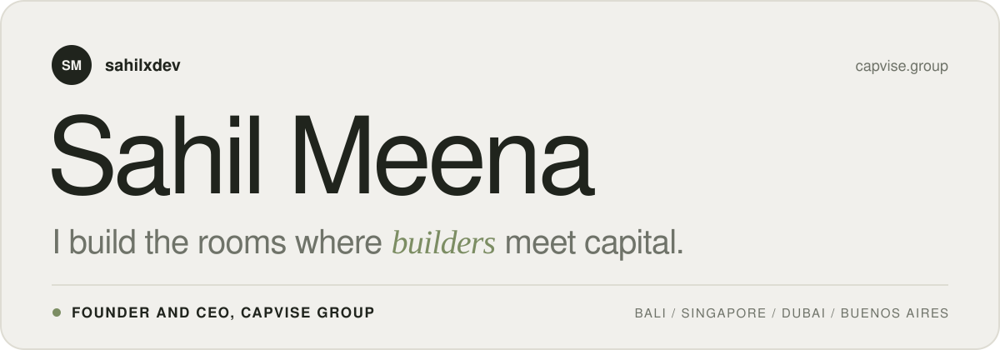

<a href="https://sahil.capvise.group">
  <picture>
    <source media="(prefers-color-scheme: dark)" srcset="assets/banner-dark.svg">
    
  </picture>
</a>

 

I'm the founder and CEO of [Capvise Group](https://capvise.group), a group of eight ventures across capital, technology, media and communities. Its flagship, [Capvise Global](https://global.capvise.group), runs founder and investor rooms alongside major conferences.

I came to this as a builder. I've shipped full-stack products since 2023, worked hands-on with open-source image and video models, and I still ship code.

[Portfolio](https://sahil.capvise.group) · [X](https://x.com/sahilxdev) · [LinkedIn](https://linkedin.com/in/sahilxdev) · [Telegram](https://t.me/sahilxdev) · [Email](mailto:sahil@capvise.group)

## Code

### [Cwtch](https://github.com/sahilxdev/cwtch-public)

A Chrome extension for private two-person watch parties on Netflix, Prime Video and YouTube. It keeps play, pause and seek in sync and adds room chat, reactions and shared timestamped moments. Room messages are encrypted in the extension with AES-GCM before they reach a small WebSocket relay. Open source under MIT, 2026.

`Chrome MV3` `JavaScript` `Node.js` `WebSocket` `Docker`

### [OmniSweep](https://github.com/sahilxdev/Omni_Sweep)

A gas relayer for wallets stuck with token dust and no gas to move it. It fronts the gas, repays itself from the swap, and bridges what is left across chains, so the user pays nothing upfront. Built at ETHGlobal Buenos Aires, November 2025. [See the showcase](https://ethglobal.com/showcase/omnisweep-h5pck).

`Solidity` `LayerZero V2` `1inch` `Next.js` `ethers.js`

### [HyperSight Explorer](https://github.com/sahilxdev/hypersightexplorer)

A real-time block explorer for Hyperliquid, with live blocks and transactions, hash-aware search, mainnet and testnet switching, and a whale tracker. Built for the HyperEVM Hackathon, 2025.

`Next.js` `TypeScript` `TanStack Query` `Lava RPC`

## Rooms

In 2025, Capvise Global ran four founder and investor rooms in four countries in four months.

<table>
  <tr>
    <td align="center" width="25%"><h3>6,400+</h3>applications</td>
    <td align="center" width="25%"><h3>950+</h3>seats</td>
    <td align="center" width="25%"><h3>4</h3>countries</td>
    <td align="center" width="25%"><h3>12</h3>speakers</td>
  </tr>
</table>

| When | City | Room | Alongside | Seats | Applications |
| :-- | :-- | :-- | :-- | --: | --: |
| Aug 2025 | Bali | Founder × VC Happy Hour | Coinfest Asia | 100+ | 600+ |
| Sep to Oct 2025 | Singapore | Founder × VC Summit | TOKEN2049 | 500 | 4,000+ |
| Oct 2025 | Dubai | Founder × VC Happy Hour | Blockchain Life | 150+ | 600+ |
| Nov 2025 | Buenos Aires | Somnia Dev City | Devconnect Argentina | 200 | 1,200+ |

Speakers came from Animoca Brands, Venom Foundation, Camp Network, Manta Network, Bitcoin.com, Somnia Network and others.

**Next: 2027.** Sixteen rooms are on the calendar across thirteen cities, from Hong Kong in February to Abu Dhabi in December. Follow along at [luma.com/capvise](https://luma.com/capvise).

The 2027 calendar

 

| Month | Room | City |
| :-- | :-- | :-- |
| Feb | Whiskey & Whales | Hong Kong |
| Apr | Curators & Allocators | Cannes |
| Apr | ASEAN Rails | Bangkok |
| May | Whiskey & Whales | Miami |
| May | The MiCA Table | Amsterdam |
| Jun | After the Bell | New York |
| Jul | Hash & Capital | Nashville |
| Aug | Whiskey & Whales | Bali |
| Aug | Family Office Table | Hong Kong |
| Aug | Agents & Apps | San Francisco |
| Oct | Asia Capital Night | Singapore |
| Oct | Agentic Commerce | Las Vegas |
| Nov | Tokenised Funds | Singapore |
| Nov | Whiskey & Whales | Bangkok |
| Dec | Whiskey & Whales | Dubai |
| Dec | Sovereign Capital | Abu Dhabi |

## Capvise Group

Eight independent ventures, started in January 2025.

| Venture | What it does |
| :-- | :-- |
| [Capvise Global](https://global.capvise.group) | Capital. Founder and investor rooms, introductions and fundraising support. |
| [Capvise Labs](https://labs.capvise.group) | Technology. Experiments with AI. |
| [Capvise Media](https://media.capvise.group) | Media. Technology journalism and campaigns. |
| [Capvise Growth](https://growth.capvise.group) | Marketing. Market entry and audience acquisition. |
| [Capvise Events](https://events.capvise.group) | Events. Event production. |
| [Creator Network](https://creators.capvise.group) | Creators. Creator collaborations and creator businesses. |
| [Capvise Club](https://club.capvise.group) | Communities. Technology communities and the companies that work with them. |
| [The Rejected Club](https://rejectedclub.com) | Founders. Founder curation. |

## Path

| Year | Milestones |
| :-- | :-- |
| 2026 | Sat on the evaluation panel at Claude Impact Lab. Open-sourced Cwtch. |
| 2025 | Founded Capvise Group. COO at BackersStage, April to December. Ran four rooms in four countries. Built OmniSweep at ETHGlobal Buenos Aires. |
| 2024 | AI engineering with open-source image and video models. Data annotation at Innodata. |
| 2023 | Started shipping full-stack products. |

## Stack

| Area | Tools |
| :-- | :-- |
| **Web** | TypeScript, JavaScript, Next.js, React, Node.js, Express, Tailwind CSS, Socket.io |
| **Data** | PostgreSQL, MongoDB, Redis, Prisma |
| **AI** | Python, Stable Diffusion, ComfyUI, AnimateDiff, Segment Anything 2 |
| **Onchain** | Solidity, LayerZero V2, 1inch, ethers.js, wagmi |
| **Infra** | Docker, AWS, Cloudflare, Vercel, Nginx |

 

  Building something, or raising for it? Write to <a href="mailto:sahil@capvise.group">sahil@capvise.group</a>.

